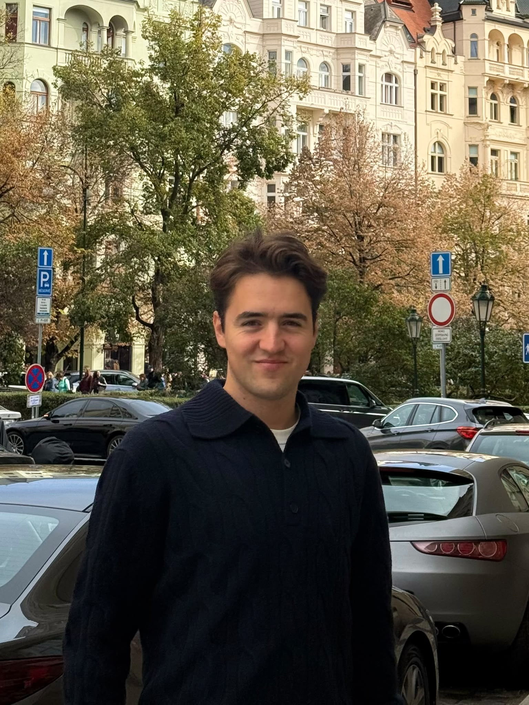

  

  <em>Mechatronics Engineer · Machine Vision · Robotics · Applied R&D</em>

I'm a Mechatronics Engineer with a background in Mechanical Engineering. My career has taken me through different areas of engineering, from mechanical design and metrology to robotics, computer vision and industrial image processing.
## Career

**Intom GmbH — Software Engineer**  
_Stockach, Germany · March 2025 – May 2026_

Worked on the development of image processing methods for industrial computed tomography (CT).

A major part of my work focused on image restoration, particularly deblurring. I investigated the physical causes of image blur in CT systems, developed system-specific Point Spread Function (PSF) models and implemented deconvolution algorithms to recover fine image details while controlling noise amplification and reconstruction artifacts. I also developed validation methods to evaluate image quality across different materials, geometries and acquisition configurations.

Alongside this, I explored deep-learning approaches to image denoising, including self-supervised methods that do not require clean reference images for training. I also worked on neural network architectures, training strategies and computer vision pipelines for detecting and segmenting defects such as pores and cracks.

Beyond algorithm development, I worked on bringing these methods into industrial software. This involved performance optimization, automated testing, code quality assurance and adapting computational methods to the requirements of real CT systems.

**TK Elevator — Project Engineering Intern**  
_Mieres, Spain · February 2023 – September 2023_

Joined the Project Engineering Department, working on engineering changes and product documentation for elevator systems.

My work involved modifying and developing 3D CAD designs using Siemens NX, managing product data and engineering changes through Teamcenter PLM, and preparing technical drawings and bills of materials. I also worked with workshop feedback to coordinate design updates and support their implementation, as well as standardizing customer documentation for installation, operation and maintenance.

This experience gave me an insight into how engineering design, manufacturing requirements, technical documentation and project coordination come together in an industrial environment.

**University Institute of Industrial Technology of Asturias (IUTA) — Research Intern**  
_Spain · September 2021 – January 2022_

Worked on research projects involving metrology, reverse engineering and dimensional inspection.

I used Coordinate Measuring Machines (CMMs) and Laser Triangulation Sensors to acquire measurement data, and processed 3D point clouds using Geomagic Control X and 3DReshaper. This involved analysing geometric deviations and extracting dimensional information from measured parts, with a focus on measurement accuracy and precision.

## Education

### Master's Degree in Mechatronics — EU4M

_September 2023 – September 2025_

Joint international Master's programme completed at three European universities:

- University of Oviedo, Spain
    
- École Nationale Supérieure de Mécanique et des Microtechniques (ENSMM), Besançon, France
    
- Hochschule Karlsruhe, Germany
    

The programme brought together different engineering disciplines, including mechanical systems, electronics, control engineering, robotics, automation and computational methods.

My Master's thesis, _Algorithmic and AI-based Methods for CT Image Denoising and Deblurring_, focused on developing and evaluating methods to improve image quality in industrial computed tomography.

### Bachelor's Degree in Mechanical Engineering

_September 2016 – July 2022_

University of Oviedo, Spain, including an Erasmus exchange at the University of Florence, Italy.

This degree provided my foundation in mechanical engineering, covering areas such as mechanics, materials, manufacturing, mechanical design, thermodynamics and engineering analysis.

My Bachelor's thesis, _Comparison of Chemical and Mechanical Surface Treatments on Metallic Precision Spheres for Use as Optical Reference Artifacts_, focused on surface treatment methods for precision metrology applications.
## Projects

- [[Motion Capture of a Pen to Control a Universal Robot]] 
## Find me elsewhere

- [LinkedIn](https://www.linkedin.com/in/pelayo-felgueroso-coto/)
    
- [GitHub](https://github.com/pelayo-felgueroso) 

