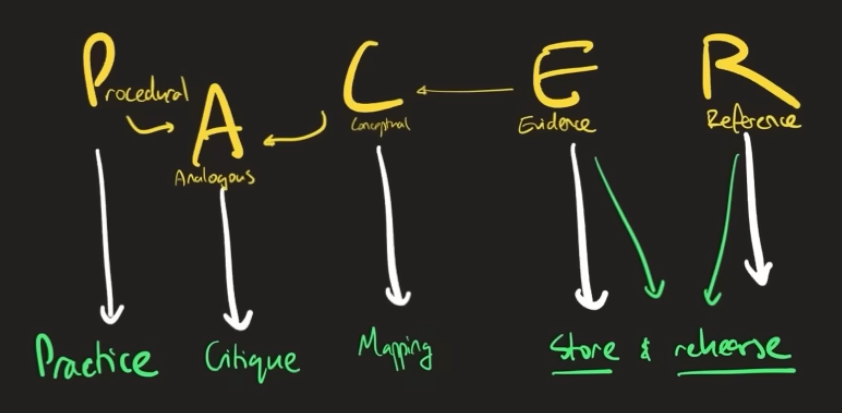

## Explanation

The PACER Method is a learning system designed to improve how we retain and use information. It separates learning into two stages: **consumption**, when we read or study new information, and **digestion**, when we process it so that it becomes part of our long-term knowledge. What goes in your brain is not as important as what stays in your brain.

PACER divides information into five categories, each with a different way of processing it:

**Procedural (P)** refers to knowledge about how to do something. The best way to learn it is through **practice** and by applying it as soon as possible. E.g. coding and languages.

**Analogous (A)** is new information that connects to something we already know. The recommended approach is to create analogies and **critique** where the similarities and differences lie. 

**Conceptual (C)** includes ideas, principles, explanations and relationships between concepts. The best way to process it is through **mapping**, connecting ideas and organising knowledge into a network rather than memorising isolated facts. 

**Evidence (E)** consists of facts, statistics and specific details that support or illustrate conceptual knowledge. These should be **stored** and later **rehearsed** by recalling and applying them. 

**Reference (R)** includes specific details that may be useful to look up or recall later but do not significantly affect our conceptual understanding. These should also be stored and **rehearsed** using techniques such as flashcards and spaced repetition.

The central idea is that reading more does not necessarily mean learning more. Information needs to be processed after it is consumed. The time spent reading should therefore be balanced with the time spent practising, connecting ideas, organising knowledge and reviewing important details.

The goal is not to remember every word, but to retain the knowledge that matters and understand it well enough to use it.

## Resources

_Learn more from external sources._

[PACER Method: How to Remember Everything You Read](https://www.youtube.com/)

## Related concepts

_Explore the knowledge network._

- [[Note-Taking]]
    
- [[Obsidian]]
