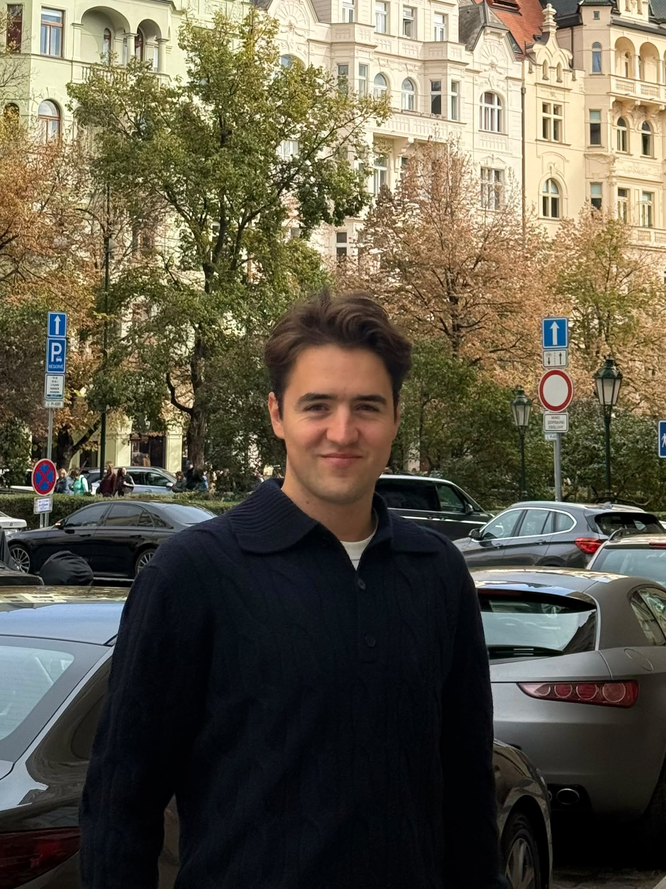

_Mechatronics Engineer · Machine Vision · Robotics · Applied R&D_

  

## About me

I'm a Mechatronics Engineer with a background in Mechanical Engineering and experience in Robotics, Machine Vision and Image Processing.

I enjoy exploring different areas of engineering and understanding how things work.

## Find me elsewhere

- [LinkedIn](https://www.linkedin.com/in/pelayo-felgueroso-coto/)
    
- [GitHub](https://github.com/pelayo-felgueroso) 
## Projects

- [[Motion Capture of a Pen to Control a Universal Robot]] 

