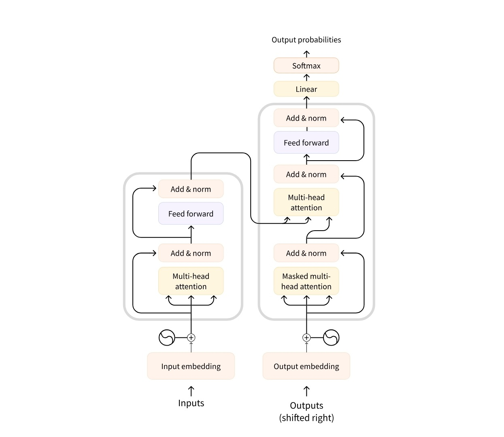

## Explanation

The Transformer is a neural network architecture designed to process sequences of data, especially text. It was introduced in the paper _Attention Is All You Need_ in 2017.

The original Transformer architecture looked like this, with an encoder on the left and a decoder on the right:

**Attention** is the mechanism that lets the model weigh which earlier tokens are relevant for predicting the next one. It's the core of the transformer architecture, and the reason these models work so well.

For example, when processing a sentence, the model can use information from other words in the sentence to understand the meaning of a particular word. This helps it capture relationships between words, even when they are far apart.

Unlike earlier sequence models that processed information step by step, Transformers can process many elements of a sequence in parallel during training. This makes them suitable for training large models on extensive datasets.

A Transformer typically uses several layers of attention and feed-forward networks. Depending on its design, it can be used for tasks such as text classification, translation, text generation and image processing.

Transformers are the foundation of many modern [[LLM]]s and other generative AI systems. They are also used beyond language, for example in computer vision and robotics.

There are 3 types of transformers:

1. **Encoders**  
    An encoder-based Transformer takes text (or other data) as input and outputs a dense representation (or embedding) of that text.
    
    - **Example**: BERT from Google
    - **Use Cases**: Text classification, semantic search, Named Entity Recognition
    - **Typical Size**: Millions of parameters
2. **Decoders**  
    A decoder-based Transformer focuses **on generating new tokens to complete a sequence, one token at a time**.
    
    - **Example**: Llama from Meta
    - **Use Cases**: Text generation, chatbots, code generation
    - **Typical Size**: Billions (in the US sense, i.e., 10^9) of parameters
3. **Seq2Seq (Encoder–Decoder)**  
    A sequence-to-sequence Transformer _combines_ an encoder and a decoder. The encoder first processes the input sequence into a context representation, then the decoder generates an output sequence.
    
    - **Example**: T5, BART
    - **Use Cases**: Translation, Summarization, Paraphrasing
    - **Typical Size**: Millions of parameters

## Resources

_Learn more from external sources._

- [Hugging Face – Transformer Models](https://huggingface.co/docs/transformers/en/index)
    
- [The Illustrated Transformer – Jay Alammar](https://jalammar.github.io/illustrated-transformer/)
    
- [Attention Is All You Need – Original Paper](https://arxiv.org/abs/1706.03762)
    
- [Computerphile – AI Language  Models & Transformers](https://www.youtube.com/watch?v=rURRYI66E54)
## Related concepts

_Explore the knowledge network._

- [[Neural Networks]]
    
- [[Deep Learning]]
    
- [[Machine Learning]]
    
- [[LLM]]
    
- [[Tokenization]]
    
- [[Embedding]]
    
- [[Generative AI]]